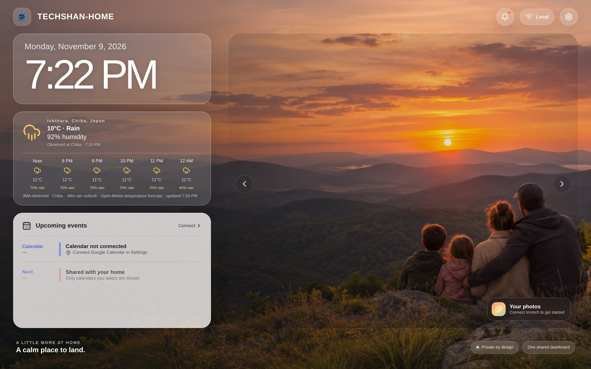
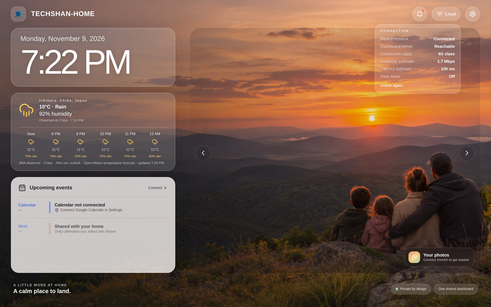
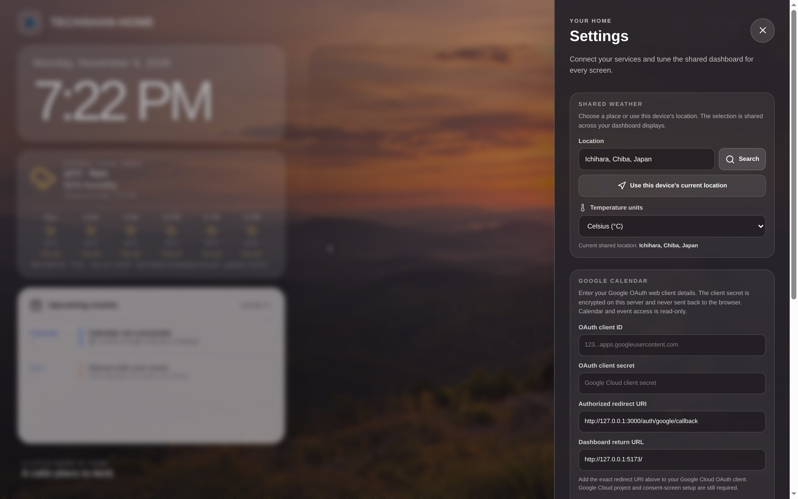
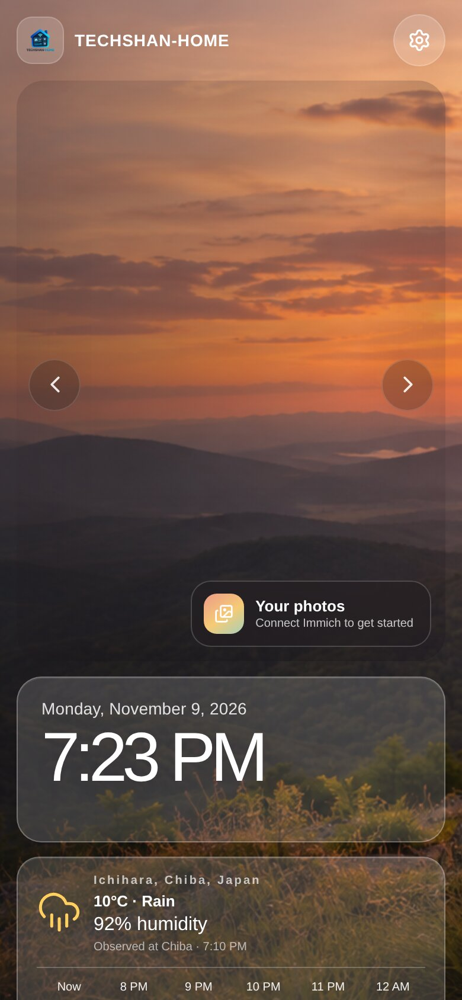

# TECHSHAN-HOME

A self-hosted responsive home dashboard built with Svelte, Vite, Fastify, and shared Zod contracts.

## Screenshots

Captured from the running container image.



*Desktop dashboard: live clock, JMA + Open-Meteo weather, calendar panel, and the photo stage.*



*The top-bar connection indicator reads live device network state: browser connectivity, Network Information API estimates, and a dashboard-server health probe.*



*Settings drawer for shared weather, Google Calendar, Immich, and **brand name/logo**.*

<p>
  
</p>

*The same dashboard on a phone.*

## Current implementation

The dashboard follows the photo-first reference with a live local clock, responsive weather and calendar panels, an Immich photo stage, and a Settings drawer. Weather uses Open-Meteo forecasts globally. For Japan, current temperature, humidity, and recent rainfall come from the nearest Japan Meteorological Agency (JMA) observation station, and rain outlook comes from the JMA local forecast. Google Calendar supports read-only OAuth, calendar selection, and a shared event cache. Immich supports server URL and API-key setup in Settings, encrypted key storage, album selection, and a same-origin thumbnail slideshow. **Branding settings let you set a custom dashboard name and upload a logo (PNG/JPEG/WebP, up to 2 MB) shared across every screen.** The server refreshes weather and Immich photo metadata every 10 minutes and calendar events every 5 minutes. Device location uses BigDataCloud in the browser to label the forecast with a city name.

Swagger UI is available at `/api/docs/` when the API server is running. It publishes the generated OpenAPI document at `/api/docs/json` and `/api/docs/yaml`.

Full user authentication, setup protection, and SQLite storage remain planned work from `system-design.md`. Do not expose this early dashboard publicly until authentication and authorization have been implemented.

## Development

Requires Node.js 24 or newer and Corepack. Install dependencies and start the web and API development servers:

```sh
corepack pnpm install
corepack pnpm dev
```

Run type checks, unit tests, and production builds:

```sh
corepack pnpm check
corepack pnpm test
corepack pnpm build
```

Run the whole CI pipeline locally (install, type check, tests, build, and the
container image build when Docker is installed):

```sh
corepack pnpm run ci
```

The Vite UI runs at `http://127.0.0.1:5173` and proxies `/api` requests to Fastify at `http://127.0.0.1:3000`.

### Google Calendar local setup

1. In Google Cloud, create a project, enable the Google Calendar API, configure the OAuth consent screen, and create an OAuth client with application type **Web application**.
2. Open TECHSHAN-HOME Settings and copy the displayed authorized redirect URI into the Google Cloud OAuth client.
3. Paste the OAuth client ID and secret into Google Calendar Settings and save. The server creates and protects its encryption key automatically.
4. Choose **Connect Google Calendar**, authorize the owner account, and select which calendars should appear.

The integration requests `calendar.calendarlist.readonly` and `calendar.events.readonly`. OAuth client settings and refresh tokens are encrypted with AES-256-GCM and stored in the ignored `data/` directory. Google Cloud still requires project and consent-screen setup outside the app. If the consent screen is in Testing mode, add the account as a test user; Google may expire test-mode refresh tokens. See [Google's web-server OAuth guide](https://developers.google.com/identity/protocols/oauth2/web-server) for the current consent and client setup requirements.

### Immich local setup

1. Create a read-only Immich API key with album and asset read permissions.
2. In TECHSHAN-HOME Settings, enter the Immich server URL and API key, then choose **Test connection**.
3. Select one or more albums and save the selection. The slideshow rotates through selected photos every 10 seconds.

The server encrypts the API key and writes it, its generated encryption key, album selection, and photo metadata cache in the ignored `data/` directory. The browser requests thumbnails from TECHSHAN-HOME; the Immich URL and API key remain server-side. Immich metadata refreshes every ten minutes. The local-only dashboard does not yet provide sign-in, so keep it on a trusted network until authentication is implemented. See the [Immich API documentation](https://api.immich.app/) for current endpoints and API-key permissions.

## Container

`docker compose up --build -d` builds the single-container app. Port 3000 is bound to localhost for an existing reverse proxy to route. The Compose file uses no `.env` file.
